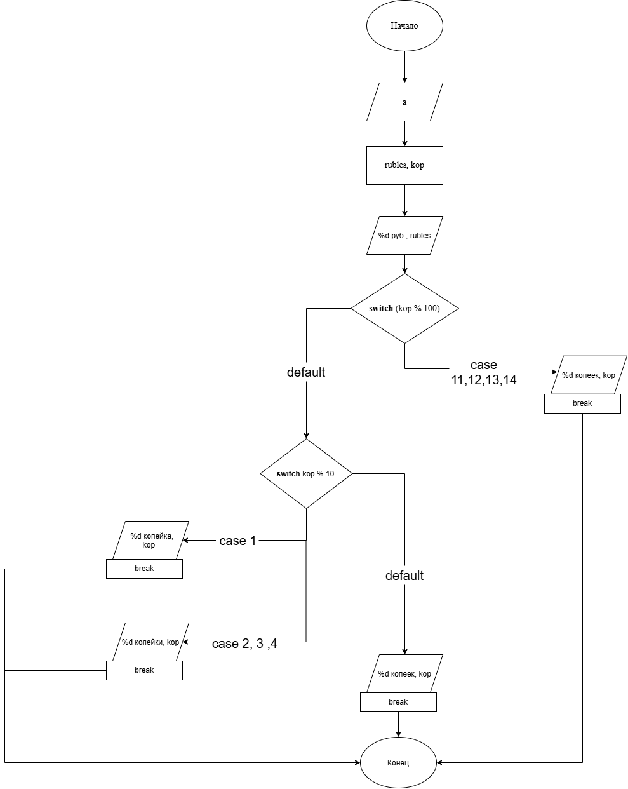

# Домашнее задание к работе номер 7
## Условие задачи
Написать программу, которая для заданной стоимости покупки в копейках выводить текстовое сообщение, отображающие значение в рублях и копейках с правильным склонением слова «копейка».
## 1. Алгоритм и блок-схема
### Алгоритм:
1. Начало.
2. Объявить переменную:
- **a** - стоимость покупки в копейках.
3. Найти стоимость в рублях и копейках.
4. Составить условия для правильного склонения слова «копейка».
5. Конец.
### Блок-схема:

## 2. Реализация программы
```c
#define _CRT_SECURE_NO_WARNINGS
#include <stdio.h>
#include <locale.h>

int main(void) {
    setlocale(LC_CTYPE, "RUS");
    int a;
    printf("Введите стоимость покупки в копейках: ");
    scanf("%d", &a);
    int rubles = a / 100;
    int kop = a % 100;
    printf("%d руб. %d ", rubles, kop);
    switch (kop % 100) {
        case 11: case 12: case 13: case 14:
            printf("копеек\n");
            break;
        default:
            switch (kop % 10) {
                case 1:
                    printf("копейка\n");
                    break;
                case 2: case 3: case 4:
                    printf("копейки\n");
                    break;
                default:
                    printf("копеек\n");
                    break;
            }
        }
    return 0;
}
```
## 3. Результаты работы программы
Пример:\
Введите стоимость покупки в копейках: 6532\
65 руб. 32 копейки

## 4. Информация о разработчике
Литуновский Максим Дмитриевич, бТИИ-261